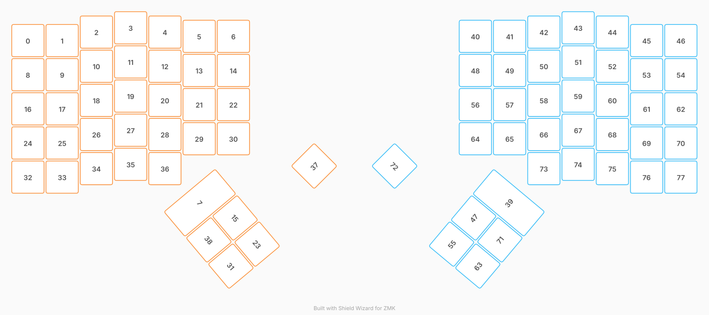

# ZMK Configuration for Ergo-Nano

*Generated by Shield Wizard for ZMK*



Download compiled firmware from the Actions tab. <https://zmk.dev/docs/user-setup#installing-the-firmware>

Edit your keymap <https://zmk.dev/docs/keymaps>.
User keymap is located at [`config/ergo_nano.keymap`](config/ergo_nano.keymap).

-----

<details>
<summary>
Shield Wizard Debug Information
</summary>

In case of broken configuration, here is the Shield Wizard internal data used to generate this configuration:

Commit: 6764e3d30a05e636ed273f525928b404e08565e9

```json
{"name":"Ergo-Nano","shield":"ergo_nano","dongle":false,"modules":[],"layout":[{"id":"01M6P04EG50CMGDZQECBWF2Q4P","part":0,"row":0,"col":0,"w":1,"h":1,"x":0,"y":0.375,"r":0,"rx":0,"ry":0},{"id":"01M6P04EG5NCMHKJ4GYZJM82YG","part":0,"row":0,"col":1,"w":1,"h":1,"x":1,"y":0.375,"r":0,"rx":0,"ry":0},{"id":"01M6P04EG5EM2J2NZW41TTH5QH","part":0,"row":0,"col":2,"w":1,"h":1,"x":2,"y":0.125,"r":0,"rx":0,"ry":0},{"id":"01M6P04EG5DY9FWTET8ZY5WDF2","part":0,"row":0,"col":3,"w":1,"h":1,"x":3,"y":0,"r":0,"rx":0,"ry":0},{"id":"01M6P04EG5QD7WNG8XE46QT41G","part":0,"row":0,"col":4,"w":1,"h":1,"x":4,"y":0.125,"r":0,"rx":0,"ry":0},{"id":"01M6P04EG5F3YBB44SPKE46PX0","part":0,"row":0,"col":5,"w":1,"h":1,"x":5,"y":0.25,"r":0,"rx":0,"ry":0},{"id":"01M6P04EG5DZTHNAD20ATJE6Y4","part":0,"row":0,"col":6,"w":1,"h":1,"x":6,"y":0.25,"r":0,"rx":0,"ry":0},{"id":"01M6P04EG6EZ69YSQ45VX7SE6Q","part":0,"row":0,"col":7,"w":1,"h":2,"x":6.25,"y":4.5,"r":50,"rx":6,"ry":4.25},{"id":"01M6P04EG6ZPJ36J5KXV0FN96X","part":0,"row":1,"col":0,"w":1,"h":1,"x":0,"y":1.375,"r":0,"rx":0,"ry":0},{"id":"01M6P04EG6BRJBKY7Q7QXRD5Z9","part":0,"row":1,"col":1,"w":1,"h":1,"x":1,"y":1.375,"r":0,"rx":0,"ry":0},{"id":"01M6P04EG52P7G7NFJX35D178N","part":0,"row":1,"col":2,"w":1,"h":1,"x":2,"y":1.125,"r":0,"rx":0,"ry":0},{"id":"01M6P04EG533RAK9HG41C4ZSAZ","part":0,"row":1,"col":3,"w":1,"h":1,"x":3,"y":1,"r":0,"rx":0,"ry":0},{"id":"01M6P04EG5WAF9Z3KY5JV73S6C","part":0,"row":1,"col":4,"w":1,"h":1,"x":4,"y":1.125,"r":0,"rx":0,"ry":0},{"id":"01M6P04EG5SCMJVF5Z9N6KQ58B","part":0,"row":1,"col":5,"w":1,"h":1,"x":5,"y":1.25,"r":0,"rx":0,"ry":0},{"id":"01M6P04EG6Z9FXEY53GVBVEV44","part":0,"row":1,"col":6,"w":1,"h":1,"x":6,"y":1.25,"r":0,"rx":0,"ry":0},{"id":"01M6P04EG6PEHCE74Y5BSQR0WF","part":0,"row":1,"col":7,"w":1,"h":1,"x":7.25,"y":4.5,"r":50,"rx":6,"ry":4.25},{"id":"01M6P04EG6K8KPD8GKZ2RZ7RFB","part":0,"row":2,"col":0,"w":1,"h":1,"x":0,"y":2.375,"r":0,"rx":0,"ry":0},{"id":"01M6P04EG646JF3WM1TB5SVPXF","part":0,"row":2,"col":1,"w":1,"h":1,"x":1,"y":2.375,"r":0,"rx":0,"ry":0},{"id":"01M6P04EG6ZEZ9S8PT2CRFMG49","part":0,"row":2,"col":2,"w":1,"h":1,"x":2,"y":2.125,"r":0,"rx":0,"ry":0},{"id":"01M6P04EG6E2CDS8RHQFVE53FH","part":0,"row":2,"col":3,"w":1,"h":1,"x":3,"y":2,"r":0,"rx":0,"ry":0},{"id":"01M6P04EG6YE4ZXT3WBRJB735K","part":0,"row":2,"col":4,"w":1,"h":1,"x":4,"y":2.125,"r":0,"rx":0,"ry":0},{"id":"01M6P04EG60S8Q09YCYPWZB5TA","part":0,"row":2,"col":5,"w":1,"h":1,"x":5,"y":2.25,"r":0,"rx":0,"ry":0},{"id":"01M6P04EG6C3YRGP4N64SBPBRJ","part":0,"row":2,"col":6,"w":1,"h":1,"x":6,"y":2.25,"r":0,"rx":0,"ry":0},{"id":"01M6P04EG6PF4FSY59MNR573YH","part":0,"row":2,"col":7,"w":1,"h":1,"x":8.25,"y":4.5,"r":50,"rx":6,"ry":4.25},{"id":"01M6P04EG6D0ZY2QQV81KNDWPX","part":0,"row":3,"col":0,"w":1,"h":1,"x":0,"y":3.375,"r":0,"rx":0,"ry":0},{"id":"01M6P04EG67YMWASHR21GZJFY0","part":0,"row":3,"col":1,"w":1,"h":1,"x":1,"y":3.375,"r":0,"rx":0,"ry":0},{"id":"01M6P04EG642TRNQRFAC5E3H7J","part":0,"row":3,"col":2,"w":1,"h":1,"x":2,"y":3.125,"r":0,"rx":0,"ry":0},{"id":"01M6P04EG65ATAB1DHP7Q4T894","part":0,"row":3,"col":3,"w":1,"h":1,"x":3,"y":3,"r":0,"rx":0,"ry":0},{"id":"01M6P04EG6T434F2E5QYSD3BNX","part":0,"row":3,"col":4,"w":1,"h":1,"x":4,"y":3.125,"r":0,"rx":0,"ry":0},{"id":"01M6P04EG6ECV04QDTE8QHM293","part":0,"row":3,"col":5,"w":1,"h":1,"x":5,"y":3.25,"r":0,"rx":0,"ry":0},{"id":"01M6P04EG6D52NBN4HWN0BE5C8","part":0,"row":3,"col":6,"w":1,"h":1,"x":6,"y":3.25,"r":0,"rx":0,"ry":0},{"id":"01M6P04EG6BJECAA9VZRNQ5GP2","part":0,"row":3,"col":7,"w":1,"h":1,"x":8.25,"y":5.5,"r":50,"rx":6,"ry":4.25},{"id":"01M6P04EG65J99QMK67EJBPHGV","part":0,"row":4,"col":0,"w":1,"h":1,"x":0,"y":4.375,"r":0,"rx":0,"ry":0},{"id":"01M6P04EG6A2WXXN9PX2G3V08G","part":0,"row":4,"col":1,"w":1,"h":1,"x":1,"y":4.375,"r":0,"rx":0,"ry":0},{"id":"01M6P04EG6Y2F8ZTK579XX3PQ5","part":0,"row":4,"col":2,"w":1,"h":1,"x":2,"y":4.125,"r":0,"rx":0,"ry":0},{"id":"01M6P04EG6TR2NQR8HSKH3RZ3M","part":0,"row":4,"col":3,"w":1,"h":1,"x":3,"y":4,"r":0,"rx":0,"ry":0},{"id":"01M6P04EG6WFJ1VJEV4W9M6VH6","part":0,"row":4,"col":4,"w":1,"h":1,"x":4,"y":4.125,"r":0,"rx":0,"ry":0},{"id":"01M6P04EG6ZXBE8MADWZ4XNP70","part":0,"row":4,"col":6,"w":1,"h":1,"x":8.15,"y":4.550000000000001,"r":-45,"rx":0,"ry":0},{"id":"01M6P04EG63SB4T6VMSQWGV565","part":0,"row":4,"col":7,"w":1,"h":1,"x":7.25,"y":5.5,"r":50,"rx":6,"ry":4.25},{"id":"01M6P2WJ5HWG76DPYGQBZFHK83","part":1,"row":5,"col":0,"w":1,"h":2,"x":13.452240161044664,"y":5.3682524563203575,"r":-50,"rx":0,"ry":0},{"id":"01M6P2WJ5HXRP9YG9R9K6ZQQM3","part":1,"row":5,"col":1,"w":1,"h":1,"x":13.064213562373093,"y":0.25,"r":0,"rx":0,"ry":0},{"id":"01M6P2WJ5G9BBZSXM4EMSXKXHD","part":1,"row":5,"col":2,"w":1,"h":1,"x":14.064213562373093,"y":0.25,"r":0,"rx":0,"ry":0},{"id":"01M6P2WJ5GZPRG2C7J4ME6EXG7","part":1,"row":5,"col":3,"w":1,"h":1,"x":15.064213562373093,"y":0.125,"r":0,"rx":0,"ry":0},{"id":"01M6P2WJ5GTW0ZBB1YAFEJ4V3V","part":1,"row":5,"col":4,"w":1,"h":1,"x":16.06421356237309,"y":0,"r":0,"rx":0,"ry":0},{"id":"01M6P2WJ5F8MW7Z1H4JM18MN94","part":1,"row":5,"col":5,"w":1,"h":1,"x":17.06421356237309,"y":0.125,"r":0,"rx":0,"ry":0},{"id":"01M6P2WJ5FF56R207D5PQD44BW","part":1,"row":5,"col":6,"w":1,"h":1,"x":18.06421356237309,"y":0.375,"r":0,"rx":0,"ry":0},{"id":"01M6P2WJ5DAX4189Q8J35TDWSY","part":1,"row":5,"col":7,"w":1,"h":1,"x":19.06421356237309,"y":0.375,"r":0,"rx":0,"ry":0},{"id":"01M6P2WJ5M5RPZWKMNFW9TKSWB","part":1,"row":6,"col":0,"w":1,"h":1,"x":12.809452551358124,"y":6.1342968994393345,"r":-50,"rx":0,"ry":0},{"id":"01M6P2WJ5MB7PJ9HY7MXYNYP9J","part":1,"row":6,"col":1,"w":1,"h":1,"x":13.064213562373093,"y":1.25,"r":0,"rx":0,"ry":0},{"id":"01M6P2WJ5KB16DCBGSEV2EAGB1","part":1,"row":6,"col":2,"w":1,"h":1,"x":14.064213562373093,"y":1.25,"r":0,"rx":0,"ry":0},{"id":"01M6P2WJ5K98N9BS0QYAWR57E8","part":1,"row":6,"col":3,"w":1,"h":1,"x":15.064213562373093,"y":1.125,"r":0,"rx":0,"ry":0},{"id":"01M6P2WJ5KGD5YNRD96ZF71600","part":1,"row":6,"col":4,"w":1,"h":1,"x":16.06421356237309,"y":1,"r":0,"rx":0,"ry":0},{"id":"01M6P2WJ5JBKAT8KQ4PDESP37Y","part":1,"row":6,"col":5,"w":1,"h":1,"x":17.06421356237309,"y":1.125,"r":0,"rx":0,"ry":0},{"id":"01M6P2WJ5J26Y6A197HX6TY8VC","part":1,"row":6,"col":6,"w":1,"h":1,"x":18.06421356237309,"y":1.375,"r":0,"rx":0,"ry":0},{"id":"01M6P2WJ5JEEJ9ACYRHSFZT1ZK","part":1,"row":6,"col":7,"w":1,"h":1,"x":19.06421356237309,"y":1.375,"r":0,"rx":0,"ry":0},{"id":"01M6P2WJ5QVQWBNX02XJCA9GZJ","part":1,"row":7,"col":0,"w":1,"h":1,"x":12.166664941671584,"y":6.900341342558313,"r":-50,"rx":0,"ry":0},{"id":"01M6P2WJ5QNJH9CC6XJNKX7MWF","part":1,"row":7,"col":1,"w":1,"h":1,"x":13.064213562373093,"y":2.25,"r":0,"rx":0,"ry":0},{"id":"01M6P2WJ5Q9M7RKC1K3QXK916T","part":1,"row":7,"col":2,"w":1,"h":1,"x":14.064213562373093,"y":2.25,"r":0,"rx":0,"ry":0},{"id":"01M6P2WJ5PQ3H1XKVWPNV53Z52","part":1,"row":7,"col":3,"w":1,"h":1,"x":15.064213562373093,"y":2.125,"r":0,"rx":0,"ry":0},{"id":"01M6P2WJ5N8XN50TW68R5H4EWQ","part":1,"row":7,"col":4,"w":1,"h":1,"x":16.06421356237309,"y":2,"r":0,"rx":0,"ry":0},{"id":"01M6P2WJ5N3HPEK8BM90MFQNJN","part":1,"row":7,"col":5,"w":1,"h":1,"x":17.06421356237309,"y":2.125,"r":0,"rx":0,"ry":0},{"id":"01M6P2WJ5NM72WCCETDX8G9PS1","part":1,"row":7,"col":6,"w":1,"h":1,"x":18.06421356237309,"y":2.375,"r":0,"rx":0,"ry":0},{"id":"01M6P2WJ5M0MZZ0V8XHPZN7YAV","part":1,"row":7,"col":7,"w":1,"h":1,"x":19.06421356237309,"y":2.375,"r":0,"rx":0,"ry":0},{"id":"01M6P2WJ5T3CW1P2C6MVV2BP1W","part":1,"row":8,"col":0,"w":1,"h":1,"x":12.932709384790563,"y":7.543128952244853,"r":-50,"rx":0,"ry":0},{"id":"01M6P2WJ5TBDDTKWG31MW293R2","part":1,"row":8,"col":1,"w":1,"h":1,"x":13.064213562373093,"y":3.25,"r":0,"rx":0,"ry":0},{"id":"01M6P2WJ5SJ12412A0JSGRNVC1","part":1,"row":8,"col":2,"w":1,"h":1,"x":14.064213562373093,"y":3.25,"r":0,"rx":0,"ry":0},{"id":"01M6P2WJ5R01M8F03S7KQ8Q2QX","part":1,"row":8,"col":3,"w":1,"h":1,"x":15.064213562373093,"y":3.125,"r":0,"rx":0,"ry":0},{"id":"01M6P2WJ5RKQEHRWNFBW7N96GA","part":1,"row":8,"col":4,"w":1,"h":1,"x":16.06421356237309,"y":3,"r":0,"rx":0,"ry":0},{"id":"01M6P2WJ5RSAYARPT4NFWV81E0","part":1,"row":8,"col":5,"w":1,"h":1,"x":17.06421356237309,"y":3.125,"r":0,"rx":0,"ry":0},{"id":"01M6P2WJ5QT3B579YPZP5MYYDF","part":1,"row":8,"col":6,"w":1,"h":1,"x":18.06421356237309,"y":3.375,"r":0,"rx":0,"ry":0},{"id":"01M6P2WJ5QQ8GRJVH2ZEW5YX1N","part":1,"row":8,"col":7,"w":1,"h":1,"x":19.06421356237309,"y":3.375,"r":0,"rx":0,"ry":0},{"id":"01M6P2WJ5WMM3XZ9GW1SB9GVY6","part":1,"row":9,"col":0,"w":1,"h":1,"x":13.575496994477103,"y":6.777084509125874,"r":-50,"rx":0,"ry":0},{"id":"01M6P2WJ5W67SG8MHZN3ST2JX1","part":1,"row":9,"col":1,"w":1,"h":1,"x":11.207106781186544,"y":3.8428932188134546,"r":45,"rx":0,"ry":0},{"id":"01M6P2WJ5VAZH0KP6FAEESZXC7","part":1,"row":9,"col":3,"w":1,"h":1,"x":15.064213562373093,"y":4.125,"r":0,"rx":0,"ry":0},{"id":"01M6P2WJ5VRVTNSK9XZ8RPZX75","part":1,"row":9,"col":4,"w":1,"h":1,"x":16.06421356237309,"y":4,"r":0,"rx":0,"ry":0},{"id":"01M6P2WJ5V115T4HH3G9BKCQ89","part":1,"row":9,"col":5,"w":1,"h":1,"x":17.06421356237309,"y":4.125,"r":0,"rx":0,"ry":0},{"id":"01M6P2WJ5VXH7PXCCQ1BX1RH2C","part":1,"row":9,"col":6,"w":1,"h":1,"x":18.06421356237309,"y":4.375,"r":0,"rx":0,"ry":0},{"id":"01M6P2WJ5TSKZ3XMT8RJ9CGTDP","part":1,"row":9,"col":7,"w":1,"h":1,"x":19.06421356237309,"y":4.375,"r":0,"rx":0,"ry":0}],"parts":[{"name":"leftencoder","controller":"nice_nano_v2","pins":{"d5":{"usage":"kscan","kscan":"01M6P2M4HRCX29E5VJQ8RSWJXY","role":"input"},"d6":{"usage":"kscan","kscan":"01M6P2M4HRCX29E5VJQ8RSWJXY","role":"input"},"d7":{"usage":"kscan","kscan":"01M6P2M4HRCX29E5VJQ8RSWJXY","role":"input"},"d8":{"usage":"kscan","kscan":"01M6P2M4HRCX29E5VJQ8RSWJXY","role":"input"},"d9":{"usage":"kscan","kscan":"01M6P2M4HRCX29E5VJQ8RSWJXY","role":"input"},"d21":{"usage":"kscan","kscan":"01M6P2M4HRCX29E5VJQ8RSWJXY","role":"output"},"d20":{"usage":"kscan","kscan":"01M6P2M4HRCX29E5VJQ8RSWJXY","role":"output"},"d19":{"usage":"kscan","kscan":"01M6P2M4HRCX29E5VJQ8RSWJXY","role":"output"},"d18":{"usage":"kscan","kscan":"01M6P2M4HRCX29E5VJQ8RSWJXY","role":"output"},"d15":{"usage":"kscan","kscan":"01M6P2M4HRCX29E5VJQ8RSWJXY","role":"output"},"d14":{"usage":"kscan","kscan":"01M6P2M4HRCX29E5VJQ8RSWJXY","role":"output"},"d16":{"usage":"kscan","kscan":"01M6P2M4HRCX29E5VJQ8RSWJXY","role":"output"},"d10":{"usage":"kscan","kscan":"01M6P2M4HRCX29E5VJQ8RSWJXY","role":"output"},"d1":{"usage":"device","deviceId":"01M6P2RK7G477SKH5ARMJ1PKBF","role":"cs"},"d2":{"usage":"bus","bus":"spi0","role":"mosi"},"d3":{"usage":"bus","bus":"spi0","role":"sck"},"d0":{"usage":"encoder","encoderId":"01M6P2TPKQD2S15X6CPJ3AWA17","role":"pinA"},"d4":{"usage":"encoder","encoderId":"01M6P2TPKQD2S15X6CPJ3AWA17","role":"pinB"}},"kscans":[{"kind":"matrix","id":"01M6P2M4HRCX29E5VJQ8RSWJXY","diodes":true}],"keys":{"01M6P04EG50CMGDZQECBWF2Q4P":{"input":"d5","output":"d21"},"01M6P04EG5NCMHKJ4GYZJM82YG":{"input":"d5","output":"d20"},"01M6P04EG5EM2J2NZW41TTH5QH":{"input":"d5","output":"d19"},"01M6P04EG5DY9FWTET8ZY5WDF2":{"input":"d5","output":"d18"},"01M6P04EG5QD7WNG8XE46QT41G":{"input":"d5","output":"d15"},"01M6P04EG5F3YBB44SPKE46PX0":{"input":"d5","output":"d14"},"01M6P04EG5DZTHNAD20ATJE6Y4":{"input":"d5","output":"d16"},"01M6P04EG6ZPJ36J5KXV0FN96X":{"input":"d6","output":"d21"},"01M6P04EG6BRJBKY7Q7QXRD5Z9":{"input":"d6","output":"d20"},"01M6P04EG52P7G7NFJX35D178N":{"input":"d6","output":"d19"},"01M6P04EG533RAK9HG41C4ZSAZ":{"input":"d6","output":"d18"},"01M6P04EG5WAF9Z3KY5JV73S6C":{"input":"d6","output":"d15"},"01M6P04EG5SCMJVF5Z9N6KQ58B":{"input":"d6","output":"d14"},"01M6P04EG6Z9FXEY53GVBVEV44":{"input":"d6","output":"d16"},"01M6P04EG6K8KPD8GKZ2RZ7RFB":{"input":"d7","output":"d21"},"01M6P04EG646JF3WM1TB5SVPXF":{"input":"d7","output":"d20"},"01M6P04EG6ZEZ9S8PT2CRFMG49":{"input":"d7","output":"d19"},"01M6P04EG6E2CDS8RHQFVE53FH":{"input":"d7","output":"d18"},"01M6P04EG6YE4ZXT3WBRJB735K":{"input":"d7","output":"d15"},"01M6P04EG60S8Q09YCYPWZB5TA":{"input":"d7","output":"d14"},"01M6P04EG6C3YRGP4N64SBPBRJ":{"input":"d7","output":"d16"},"01M6P04EG6D0ZY2QQV81KNDWPX":{"input":"d8","output":"d21"},"01M6P04EG67YMWASHR21GZJFY0":{"input":"d8","output":"d20"},"01M6P04EG642TRNQRFAC5E3H7J":{"input":"d8","output":"d19"},"01M6P04EG65ATAB1DHP7Q4T894":{"input":"d8","output":"d18"},"01M6P04EG6T434F2E5QYSD3BNX":{"input":"d8","output":"d15"},"01M6P04EG6ECV04QDTE8QHM293":{"input":"d8","output":"d14"},"01M6P04EG6D52NBN4HWN0BE5C8":{"input":"d8","output":"d16"},"01M6P04EG65J99QMK67EJBPHGV":{"input":"d9","output":"d21"},"01M6P04EG6A2WXXN9PX2G3V08G":{"input":"d9","output":"d20"},"01M6P04EG6Y2F8ZTK579XX3PQ5":{"input":"d9","output":"d19"},"01M6P04EG6TR2NQR8HSKH3RZ3M":{"input":"d9","output":"d18"},"01M6P04EG6WFJ1VJEV4W9M6VH6":{"input":"d9","output":"d15"},"01M6P04EG6EZ69YSQ45VX7SE6Q":{"input":"d5","output":"d10"},"01M6P04EG6ZXBE8MADWZ4XNP70":{"input":"d9","output":"d16"},"01M6P04EG6BJECAA9VZRNQ5GP2":{"input":"d8","output":"d10"},"01M6P04EG63SB4T6VMSQWGV565":{"input":"d9","output":"d10"},"01M6P04EG6PF4FSY59MNR573YH":{"input":"d7","output":"d10"},"01M6P04EG6PEHCE74Y5BSQR0WF":{"input":"d6","output":"d10"}},"encoders":[{"id":"01M6P2TPKQD2S15X6CPJ3AWA17"}],"buses":{"spi0":{"type":"spi","devices":[{"id":"01M6P2RK7G477SKH5ARMJ1PKBF","type":"niceview"}]}}},{"name":"rightencoder","controller":"nice_nano_v2","pins":{"d5":{"usage":"kscan","kscan":"01M6P2XRDXATNQ1C2FECM9SYJ2","role":"input"},"d6":{"usage":"kscan","kscan":"01M6P2XRDXATNQ1C2FECM9SYJ2","role":"input"},"d7":{"usage":"kscan","kscan":"01M6P2XRDXATNQ1C2FECM9SYJ2","role":"input"},"d8":{"usage":"kscan","kscan":"01M6P2XRDXATNQ1C2FECM9SYJ2","role":"input"},"d9":{"usage":"kscan","kscan":"01M6P2XRDXATNQ1C2FECM9SYJ2","role":"input"},"d10":{"usage":"kscan","kscan":"01M6P2XRDXATNQ1C2FECM9SYJ2","role":"output"},"d16":{"usage":"kscan","kscan":"01M6P2XRDXATNQ1C2FECM9SYJ2","role":"output"},"d14":{"usage":"kscan","kscan":"01M6P2XRDXATNQ1C2FECM9SYJ2","role":"output"},"d15":{"usage":"kscan","kscan":"01M6P2XRDXATNQ1C2FECM9SYJ2","role":"output"},"d18":{"usage":"kscan","kscan":"01M6P2XRDXATNQ1C2FECM9SYJ2","role":"output"},"d19":{"usage":"kscan","kscan":"01M6P2XRDXATNQ1C2FECM9SYJ2","role":"output"},"d20":{"usage":"kscan","kscan":"01M6P2XRDXATNQ1C2FECM9SYJ2","role":"output"},"d21":{"usage":"kscan","kscan":"01M6P2XRDXATNQ1C2FECM9SYJ2","role":"output"},"d3":{"usage":"bus","bus":"spi0","role":"sck"},"d2":{"usage":"bus","bus":"spi0","role":"mosi"},"d1":{"usage":"device","deviceId":"01M6P2ZM7PT66WHFAHAT26H5AP","role":"cs"},"d0":{"usage":"encoder","encoderId":"01M6P300JGAF9NGPDY83ATSN5D","role":"pinB"},"d4":{"usage":"encoder","encoderId":"01M6P300JGAF9NGPDY83ATSN5D","role":"pinA"}},"kscans":[{"kind":"matrix","id":"01M6P2XRDXATNQ1C2FECM9SYJ2","diodes":true}],"keys":{"01M6P2WJ5DAX4189Q8J35TDWSY":{"input":"d5","output":"d21"},"01M6P2WJ5FF56R207D5PQD44BW":{"input":"d5","output":"d20"},"01M6P2WJ5F8MW7Z1H4JM18MN94":{"input":"d5","output":"d19"},"01M6P2WJ5GTW0ZBB1YAFEJ4V3V":{"input":"d5","output":"d18"},"01M6P2WJ5GZPRG2C7J4ME6EXG7":{"input":"d5","output":"d15"},"01M6P2WJ5G9BBZSXM4EMSXKXHD":{"input":"d5","output":"d14"},"01M6P2WJ5HXRP9YG9R9K6ZQQM3":{"input":"d5","output":"d16"},"01M6P2WJ5HWG76DPYGQBZFHK83":{"input":"d5","output":"d10"},"01M6P2WJ5JEEJ9ACYRHSFZT1ZK":{"input":"d6","output":"d21"},"01M6P2WJ5J26Y6A197HX6TY8VC":{"input":"d6","output":"d20"},"01M6P2WJ5JBKAT8KQ4PDESP37Y":{"input":"d6","output":"d19"},"01M6P2WJ5KGD5YNRD96ZF71600":{"input":"d6","output":"d18"},"01M6P2WJ5K98N9BS0QYAWR57E8":{"input":"d6","output":"d15"},"01M6P2WJ5KB16DCBGSEV2EAGB1":{"input":"d6","output":"d14"},"01M6P2WJ5MB7PJ9HY7MXYNYP9J":{"input":"d6","output":"d16"},"01M6P2WJ5M5RPZWKMNFW9TKSWB":{"input":"d6","output":"d10"},"01M6P2WJ5M0MZZ0V8XHPZN7YAV":{"input":"d7","output":"d21"},"01M6P2WJ5NM72WCCETDX8G9PS1":{"input":"d7","output":"d20"},"01M6P2WJ5N3HPEK8BM90MFQNJN":{"input":"d7","output":"d19"},"01M6P2WJ5N8XN50TW68R5H4EWQ":{"input":"d7","output":"d18"},"01M6P2WJ5PQ3H1XKVWPNV53Z52":{"input":"d7","output":"d15"},"01M6P2WJ5Q9M7RKC1K3QXK916T":{"input":"d7","output":"d14"},"01M6P2WJ5QNJH9CC6XJNKX7MWF":{"input":"d7","output":"d16"},"01M6P2WJ5QVQWBNX02XJCA9GZJ":{"input":"d7","output":"d10"},"01M6P2WJ5QQ8GRJVH2ZEW5YX1N":{"input":"d8","output":"d21"},"01M6P2WJ5QT3B579YPZP5MYYDF":{"input":"d8","output":"d20"},"01M6P2WJ5RSAYARPT4NFWV81E0":{"input":"d8","output":"d19"},"01M6P2WJ5RKQEHRWNFBW7N96GA":{"input":"d8","output":"d18"},"01M6P2WJ5R01M8F03S7KQ8Q2QX":{"input":"d8","output":"d15"},"01M6P2WJ5SJ12412A0JSGRNVC1":{"input":"d8","output":"d14"},"01M6P2WJ5TBDDTKWG31MW293R2":{"input":"d8","output":"d16"},"01M6P2WJ5T3CW1P2C6MVV2BP1W":{"input":"d8","output":"d10"},"01M6P2WJ5TSKZ3XMT8RJ9CGTDP":{"input":"d9","output":"d21"},"01M6P2WJ5VXH7PXCCQ1BX1RH2C":{"input":"d9","output":"d20"},"01M6P2WJ5V115T4HH3G9BKCQ89":{"input":"d9","output":"d19"},"01M6P2WJ5VRVTNSK9XZ8RPZX75":{"input":"d9","output":"d18"},"01M6P2WJ5VAZH0KP6FAEESZXC7":{"input":"d9","output":"d15"},"01M6P2WJ5W67SG8MHZN3ST2JX1":{"input":"d9","output":"d16"},"01M6P2WJ5WMM3XZ9GW1SB9GVY6":{"input":"d9","output":"d10"}},"encoders":[{"id":"01M6P300JGAF9NGPDY83ATSN5D"}],"buses":{"spi0":{"type":"spi","devices":[{"id":"01M6P2ZM7PT66WHFAHAT26H5AP","type":"niceview"}]}}}]}
```

</details>
